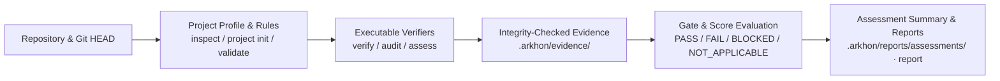

<div align="center">

# APXOH (ARKHON)

**Local-first, evidence-driven software engineering governance and assurance.**

*Evidence Before Approval. Verification Before Release.*

**Python 3.11 – 3.13** · **Apache-2.0** · **Linux · macOS · Windows** · **Zero AI Provider Required**

[Overview](#why-apxoh) · [Architecture](#architecture--workflow) · [AI Coding Agents](#using-apxoh-with-ai-coding-agents) · [Installation](#local-installation) · [Local Workflow](#local-workflow) · [CLI Reference](#cli-reference) · [Trust Model](#trust-model--boundaries)

</div>

> **Project Status — Under Active Development:** APXOH is under active development and continuous stabilization. Core deterministic verification, rule-level assessment, and evidence persistence are implemented and tested; broader rule coverage, exception governance lifecycle depth, and release preparation remain in progress. See [`ROADMAP.md`](ROADMAP.md) for current milestones.

---

## Why APXOH

Modern software teams and AI coding agents produce changes faster than informal checklists can verify them. Standard CI pipelines report whether a job exited zero, yet rarely bind each engineering rule to a clean Git commit, preserve integrity-checked evidence, or distinguish a genuine pass from a missing tool.

**APXOH (ARKHON)** provides a deterministic, local-first verification and governance engine for software repositories:

- **Deterministic authority:** Core verification and gate decisions run locally in Python with no AI provider required. AI coding agents write code and assist analysis, while APXOH verifies results independently.
- **Explicit four-state outcomes:** Every applicable rule resolves to `PASS`, `FAIL`, `BLOCKED`, or `NOT_APPLICABLE`. Missing tools, dirty working trees, or unimplemented verifiers resolve to `BLOCKED`—never `PASS`.
- **Commit-bound evidence:** `arkhon assess` requires a resolvable Git commit SHA and a clean working tree, persisting integrity-checked evidence under `.arkhon/evidence/` and run summaries under `.arkhon/reports/assessments/`.
- **Strict scope discipline:** Inferred project profiles are advisory only and never exclude rules. Only a schema-validated, explicitly declared `.arkhon/project.yaml` can mark a rule `NOT_APPLICABLE`.
- **Lightweight footprint:** Three pinned runtime dependencies (`pyyaml`, `jsonschema`, `defusedxml`) on Python `3.11–3.13` across Linux, macOS, and Windows.

---

## Contents

- [Architecture & Workflow](#architecture--workflow)
- [Using APXOH with AI Coding Agents](#using-apxoh-with-ai-coding-agents)
- [Local Installation](#local-installation)
- [Local Workflow](#local-workflow)
- [CLI Reference](#cli-reference)
- [Language Profiles & Integrations](#language-profiles--integrations)
- [Trust Model & Boundaries](#trust-model--boundaries)
- [Verification & Contributing](#verification--contributing)
- [Documentation Index](#documentation-index)
- [License](#license)

---

## Architecture & Workflow

APXOH separates project declaration, deterministic verification runners, integrity-checked evidence storage, and gate evaluation into discrete stages:



| Subsystem | Package Path | Responsibility |
| :--- | :--- | :--- |
| **CLI & Entry Point** | `src/arkhon/cli.py` | User and agent command interface (`arkhon`) |
| **Project & Language Support** | `src/arkhon/projects/`, `src/arkhon/language_support/` | Profile loading, directory marker matching, tool resolution |
| **Rules & Policies** | `src/arkhon/rules/`, `src/arkhon/policies/` | Rule catalog loading, schema validation, blocking/exception policies |
| **Verification Runners** | `src/arkhon/verification/` | Executable method registry, Mypy and optional TSAR runners |
| **Evidence Store** | `src/arkhon/evidence/` | Commit-bound, digest-verified evidence collection and persistence |
| **Assessment & Gates** | `src/arkhon/assessment/`, `src/arkhon/orchestrator/` | Rule outcomes, lifecycle stages, domain gates, and scoring |
| **Reporting & Integrations** | `src/arkhon/reporting/`, `src/arkhon/integrations/` | JSON/Markdown reports and optional external tool/model contracts |

---

## Using APXOH with AI Coding Agents

APXOH is designed to work alongside AI coding agents as an independent verification and governance companion. The repository includes [`AGENTS.md`](AGENTS.md) and [`AGENT_BOOTSTRAP.md`](AGENT_BOOTSTRAP.md) for agent onboarding, plus `arkhon install --scope project` to stage governance packs when authorized.

### When and how to use the adoption prompt

Paste the prompt below at the start of an AI coding-agent session—or place it in your project's agent instructions—when you want the agent to ground architecture decisions, implementation changes, testing, and readiness reporting in APXOH's deterministic workflow. Adoption depends on each agent's available tools, network access, and user permissions; agents should apply only the parts relevant to the current task and report their actual execution state honestly.

### Copy-ready AI coding-agent adoption prompt

```markdown
# APXOH Engineering Governance & Verification Workflow

When working on software engineering tasks in this repository (architecture, implementation,
refactoring, code review, testing, or release readiness), use APXOH as an independent,
deterministic verification and governance resource whenever it is relevant and available in
your environment.

Authoritative repository: https://github.com/mohamedelghazali/Apxoh

## 1. Operating Boundaries & Permissions
- Respect existing governing rules, user authorization, repository ownership, branch
  protection, CI/CD gates, security boundaries, data privacy, and offline or restricted
  environment constraints.
- Never modify protected governance files, bypass branch protection, disable tests, or
  weaken verification rules without explicit user authorization.
- Never claim that APXOH was consulted, installed, executed, or passed unless you actually
  performed and verified that step.

## 2. Low-Friction Discovery & Reuse
- Before applying APXOH, inspect its documentation and capabilities as relevant to the task
  (start with `AGENTS.md`, `COMPATIBILITY.md`, and `arkhon --help` if installed).
- Apply APXOH selectively: match the depth of checks to the task's scope and risk rather than
  running heavy workflows for trivial edits.
- Reuse already-read documentation or an existing local `arkhon` installation within the
  session instead of repeatedly re-downloading, reinstalling, or re-scanning unchanged files.
- If an APXOH command or setup step fails, make at most two targeted attempts to resolve
  that specific failure. If it still fails, document the blocker clearly and continue safely
  through an appropriate alternative engineering workflow.

## 3. Practical Engineering Lifecycle Integration
When APXOH is installed and relevant to the task, integrate its deterministic CLI into your
workflow:
1. Context & classification: Run `arkhon inspect . --json` and `arkhon status . --json` to
   understand the project profile, detected languages, and existing evidence state. Only run
   `arkhon project init . --name "<Name>"` if creating `.arkhon/project.yaml` is appropriate
   and authorized.
2. Governance & exceptions: Run `arkhon exceptions list --json` (read-only) to understand
   registered exceptions before proposing design or policy changes.
3. Configuration integrity: Run `arkhon validate` when modifying manifests, schemas, or
   governance rules.
4. Verification during implementation: Run targeted checks with `arkhon verify . --domain <domain>`
   or `arkhon audit . --domain <domain>` alongside the repository's native test, lint, and
   type-check suites.
5. Commit-bound assessment: On a clean Git working tree with a resolvable commit, run
   `arkhon assess .` to execute supported rule verifiers and persist integrity-checked
   evidence under `.arkhon/evidence/` and summaries under `.arkhon/reports/assessments/`.
6. Reporting: Generate structured output with `arkhon report . --format json` (or `markdown`)
   when summarizing readiness or gaps.
7. Optional integrations: Delegate security-specific verification to TSAR only when configured
   and compatible per `COMPATIBILITY.md`; never substitute unverified claims for missing tools.

## 4. Honest Evidence-Based Reporting
In your task summary, distinguish and report the exact state of APXOH usage—never conflate
these states:
- `APXOH consulted` — documentation, rules, or repository contracts were reviewed.
- `APXOH installed` — the `arkhon` package was installed or verified present locally.
- `APXOH executed` — specific `arkhon` commands were run (list exact commands).
- `APXOH verification passed` — executed checks completed with passing outcomes.
- `APXOH verification failed` — executed checks returned `FAIL` or `BLOCKED` (report details).
- `APXOH unavailable` — APXOH could not be accessed or run in this environment (state why).
- `APXOH partially applied` — only a subset of relevant checks ran (state what ran and what
  was skipped or blocked).

Treat `BLOCKED` outcomes, missing tools, and required human reviews explicitly as open items,
never as `PASS`.
```

---

## Local Installation

### Prerequisites

- **Python:** `3.11`, `3.12`, or `3.13` (`requires-python = ">=3.11,<3.14"` in [`pyproject.toml`](pyproject.toml))
- **Git:** Required on `PATH` for commit-bound assessment (`arkhon assess`)
- **Operating Systems:** Verified in CI on Linux (`ubuntu-latest`), macOS (`macos-latest`), and Windows (`windows-latest`)

### Standard local installation (from source)

APXOH is currently installed locally from the repository in an isolated virtual environment.

#### Windows (PowerShell)

```powershell
git clone https://github.com/mohamedelghazali/Apxoh.git
cd Apxoh
py -3.11 -m venv .venv
.\.venv\Scripts\Activate.ps1
python -m pip install .
```

#### Linux / macOS (bash / zsh)

```bash
git clone https://github.com/mohamedelghazali/Apxoh.git
cd Apxoh
python3.11 -m venv .venv
source .venv/bin/activate
python -m pip install .
```

### Contributor / development installation

If you plan to run the test suite, Ruff, Mypy, or contribute changes, install in editable mode with development extras:

```bash
python -m pip install -e ".[dev]"
```

### Verify the installation

```bash
arkhon version
arkhon doctor
arkhon validate
```

All three commands should exit `0` in a healthy repository checkout. For contributor installs, run `pytest` to verify the full test suite.

### Troubleshooting

| Symptom | Likely Cause | Resolution |
| :--- | :--- | :--- |
| `pip install` fails on Python version | Running Python `< 3.11` or `>= 3.14` | Recreate `.venv` using Python `3.11`, `3.12`, or `3.13`. |
| `arkhon` command not found | Virtual environment is not activated | Activate `.venv` or invoke `python -m arkhon.cli` / `.venv/bin/arkhon`. |
| `arkhon assess .` reports `BLOCKED` on commit/worktree | Directory is not a Git repo, `git` is missing from `PATH`, or uncommitted changes exist | Ensure `git` is on `PATH`, commit or stash local modifications, and re-run `arkhon assess .`. |
| Rules report `BLOCKED` for optional tools | Optional runner (e.g., `mypy` or external `tsar`) is not installed or configured | Install the required tool if applicable; APXOH intentionally reports missing verifiers as `BLOCKED` rather than `PASS`. |

See [`INSTALL.md`](INSTALL.md) and [`VERIFY_INSTALLATION.md`](VERIFY_INSTALLATION.md) for additional installation verification details.

---

## Local Workflow

Once `arkhon` is installed, you can adopt it incrementally inside any existing Git repository without disrupting existing build or CI scripts.

### 1. Inspect the repository

```bash
arkhon inspect .
arkhon inspect . --json
```

Detects languages and infers an advisory project profile from repository markers.

### 2. Initialize an explicit project declaration (optional, recommended)

```bash
arkhon project init . --name "Example App" --type application --profile universal --risk-level medium
```

Creates a schema-validated `.arkhon/project.yaml` without overwriting an existing declaration (pass `--force` only to overwrite). Only a valid explicit declaration can mark out-of-scope rules `NOT_APPLICABLE`.

### 3. Check project status and registered exceptions

```bash
arkhon status .
arkhon status . --json
arkhon exceptions list
arkhon exceptions list --json
```

`arkhon status` verifies evidence-store integrity before reporting counts. `arkhon exceptions list` is strictly read-only—exception approval, extension, and revocation remain governed operations.

### 4. Run targeted verification during development

```bash
arkhon verify . --domain all
arkhon audit . --domain testing
```

Runs configured verification runners across all domains or a single target domain while you iterate locally.

### 5. Run a commit-bound rule assessment

Ensure your working tree is clean (`git status` shows no uncommitted or untracked changes), then run:

```bash
arkhon assess .
```

APXOH executes supported verifiers for active rules, checks that `HEAD` and the working tree did not change mid-run, and writes:
- Integrity-checked evidence records under `.arkhon/evidence/`
- Run summaries under `.arkhon/reports/assessments/`

**Illustrative output** (exact rules and counts depend on your repository and installed verifiers):

```text
Project profile: universal (declared in .arkhon/project.yaml)
Rule verification execution:
  SE-CQ-002: 2/2 methods implemented
    [PASS] type-checker-execution
    [PASS] zero-type-errors-check
Rule outcomes:
  SE-CQ-002: PASS
  SE-SEC-001: BLOCKED
[BLOCKED] no score or readiness level has been computed
```

### 6. Generate a structured report

```bash
arkhon report . --format json
arkhon report . --format markdown --output .arkhon/reports/summary.md
```

### Interpreting outcomes

| Outcome | Meaning | Recommended Next Action |
| :--- | :--- | :--- |
| **`PASS`** | Executable verifier succeeded with valid, commit-bound evidence. | No remediation required for this rule. |
| **`FAIL`** | Verifier executed and detected a policy or quality violation. | Inspect the cited evidence artifact, fix the root cause, commit, and re-run `arkhon assess .`. |
| **`BLOCKED`** | Missing tool, unimplemented verifier, dirty worktree, missing commit, or required human approval. | Resolve the listed blocker or obtain required review; scores and readiness are withheld while blockers remain. |
| **`NOT_APPLICABLE`** | Excluded by a valid, explicitly declared `.arkhon/project.yaml` profile. | No action needed unless the project's scope or profile changes. |

---

## CLI Reference

All subcommands below are verified against `build_parser` in [`src/arkhon/cli.py`](src/arkhon/cli.py):

| Command | Purpose | Key Options |
| :--- | :--- | :--- |
| `arkhon version` | Print ARKHON version | `--json` |
| `arkhon doctor` | Check installation and environment health | — |
| `arkhon validate` | Validate manifest, schemas, and rules | — |
| `arkhon inspect [project]` | Detect languages and advisory project profile | `--json` |
| `arkhon project init [project]` | Create `.arkhon/project.yaml` | `--name`, `--identifier`, `--type`, `--profile`, `--risk-level`, `--description`, `--force` |
| `arkhon status [project]` | Summarize configuration, languages, and verified evidence | `--json` |
| `arkhon exceptions list` | Read-only listing of registered governance exceptions | `--registry`, `--json` |
| `arkhon verify [project]` | Run verification runners across domains | `--domain` (default: `all`) |
| `arkhon audit [project]` | Run verification for a specific domain | `--domain` (default: `testing`) |
| `arkhon assess [project]` | Execute rule verifiers, persist commit-bound evidence, evaluate gates | — |
| `arkhon report [project]` | Generate an engineering-quality report | `--format json\|markdown`, `--output` |
| `arkhon install` | Stage the agent governance pack | `--scope project\|global`, `--project`, `--force` |

---

## Language Profiles & Integrations

- **Initial language profiles (9):** Python, JavaScript, TypeScript, Java, C#, C++, Go, Rust, Ruby.
- **Explicit maturity tiers:** `planned`, `detected`, `analyzable`, `verified` (defined in `languages/`).
- **Optional TSAR integration:** TSAR is a separately versioned, optional integration for security-oriented checks. APXOH remains fully usable without TSAR. Always review [`COMPATIBILITY.md`](COMPATIBILITY.md) before relying on external tool or model integrations.

---

## Trust Model & Boundaries

APXOH is built around strict epistemic honesty:

- **No silent passes:** Missing tools, missing evidence, or unsupported verification methods always resolve to `BLOCKED`, never `PASS`.
- **CI is not a substitute for product quality:** Green CI checks validate automated gates, not every requirement or human judgment call.
- **Informative standards mappings:** Standards references in `standards/` are informative mappings and do not constitute formal compliance certification.
- **No security guarantees:** APXOH assists structured engineering assurance; it does not guarantee vulnerability-free software, replace human engineers, or substitute for an independent security audit.
- **Agent instructions are not enforcement:** Files such as `AGENTS.md` guide AI behavior but do not enforce filesystem permissions or branch protection—enforcement must be configured and verified independently.

---

## Verification & Contributing

Contributors work through pull requests targeting `main` under active branch protection (required CI gate, security gate, installation, integration, TSAR, self-test, and supply-chain checks).

```bash
ruff check src tests scripts
mypy src
pytest
```

See [`CONTRIBUTING.md`](CONTRIBUTING.md), [`GOVERNANCE.md`](GOVERNANCE.md), [`CODE_OF_CONDUCT.md`](CODE_OF_CONDUCT.md), and [`SECURITY.md`](SECURITY.md) before opening a pull request.

---

## Documentation Index

| Document | Purpose |
| :--- | :--- |
| [`AGENTS.md`](AGENTS.md) & [`AGENT_BOOTSTRAP.md`](AGENT_BOOTSTRAP.md) | AI agent operating principles and bootstrap guidance |
| [`INSTALL.md`](INSTALL.md) & [`VERIFY_INSTALLATION.md`](VERIFY_INSTALLATION.md) | Installation procedures and verification criteria |
| [`ONBOARDING.md`](ONBOARDING.md) | Developer onboarding guide |
| [`COMPATIBILITY.md`](COMPATIBILITY.md) | Integration compatibility contracts (including TSAR) |
| [`ROADMAP.md`](ROADMAP.md) & [`CHANGELOG.md`](CHANGELOG.md) | Project milestones and version history |
| [`SECURITY.md`](SECURITY.md) & [`SECURITY_AGENTS.md`](SECURITY_AGENTS.md) | Security policy and AI agent security model |
| [`SUPPORT.md`](SUPPORT.md) | Support channels and scope |

---

## License

Licensed under the [Apache License 2.0](LICENSE).
